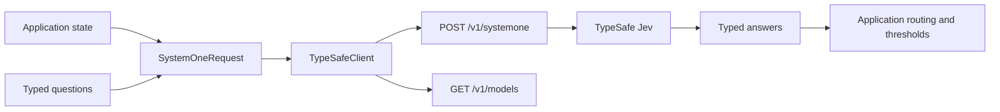
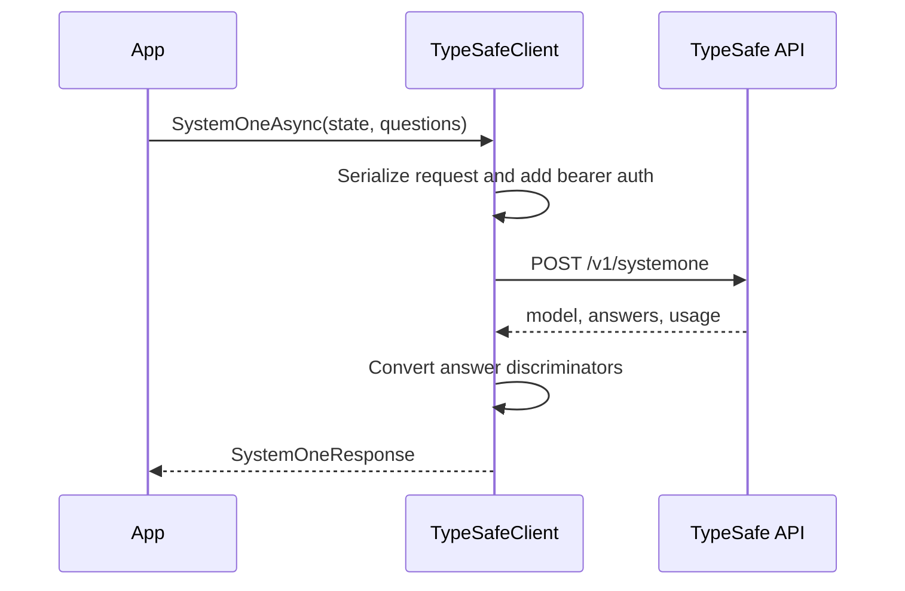

# Architecture

The SDK is a thin typed boundary over the TypeSafe HTTP API. It does not generate prompts or hide decision logic. Your code supplies state and question definitions; the service evaluates each question and returns structured answers.

## Request phase

`SystemOneAsync` validates that state and questions exist, applies the configured model, and serializes the request using `System.Text.Json`.

The request has three important fields:

| Field       | Purpose                                          |
| ----------- | ------------------------------------------------ |
| `state`     | Text, object, or array to evaluate.              |
| `model`     | Model name, `jev-latest` by default.             |
| `questions` | Named `Noul`, `Choice`, and `Score` definitions. |

Question objects are serialized through a discriminator converter so the concrete fields for `criteria` and `instructions` are preserved.

## Transport phase

`TypeSafeClient` uses an injected or internally owned `HttpClient`. It adds `Authorization: Bearer <API_KEY>`, posts JSON to `/v1/systemone`, and supports cancellation tokens on every asynchronous operation.

`Microsoft.Extensions.Resilience` supplies the Polly v8 pipeline that executes SDK retries. `RetryPolicy` controls retryable HTTP statuses (by default `408`, `429`, and `5xx`), connection failures, timeouts, backoff, jitter, `Retry-After`, and the retry budget. Per-request policies override client defaults; `MaxRetries` and `RetryDelay` remain compatibility options. A non-retryable or exhausted HTTP response becomes `TypeSafeApiException`, preserving the status code and response body. Host-owned HTTP resilience is optional and requires disabling SDK retries to avoid multiplying attempts.

## Response phase

Answers are discriminated by their `type` field:

- `noul` becomes `NoulAnswer`.
- `choice` becomes `ChoiceAnswer`.
- `score` becomes `ScoreAnswer`.

`SystemOneResponse` exposes the complete `Answers` map plus filtered `Nouls`, `Choices`, and `Scores` views.

## Data boundaries

The SDK does not persist state, upload files, or perform application routing. It sends the values supplied by the caller to the configured API endpoint and returns the service response. Keep API keys in environment variables or a secret manager rather than source code.

## Optional Microsoft AI integration

`Jev.Typesafe.Sdk` remains independent of Microsoft AI libraries. The separate `Jev.Typesafe.Sdk.Extensions.AI` package references the core SDK, `Microsoft.Extensions.AI.Abstractions`, and `Microsoft.Extensions.AI.Evaluation`.

`TypeSafeChatClient` implements `IChatClient` by sending configured questions and text-message history through `SystemOneAsync`. It returns the full answer map as JSON, exposes the original `SystemOneResponse` through `RawRepresentation`, and maps model/token usage metadata. `TypeSafeChatOptions` can override questions or supply structured state per request.

The adapter does not turn TypeSafe into a general chat model: custom JSON schemas, tool calls, sampling controls, and non-text content are unsupported. Streaming wraps a completed response rather than streaming tokens from the service.

`TypeSafeAnswerEvaluator` compares expected typed answers with response JSON using ordinal choice equality and numeric tolerances. It implements `IEvaluator` without an LLM judge, so evaluation does not make network calls. Each production package has its own unit and credential-gated integration suite.
