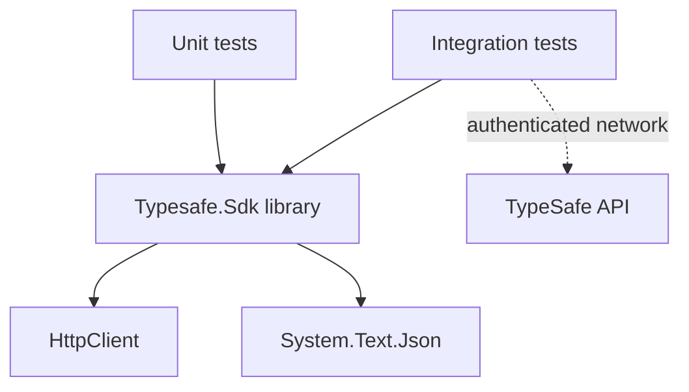

# Development guide

The repository keeps the production library small and separates live API checks from deterministic unit tests.

## Project structure

```text
typesafe-jev-dotnet-sdk/
├── src/
│   ├── Directory.Build.props
│   ├── Jev.Typesafe.Sdk/
│   │   ├── TypeSafeClient.cs
│   │   ├── Models/
│   │   ├── Serialization/
│   │   └── Jev.Typesafe.Sdk.csproj
│   └── Jev.Typesafe.Sdk.Extensions.AI/
│       ├── TypeSafeChatClient.cs
│       ├── Evaluation/
│       └── Jev.Typesafe.Sdk.Extensions.AI.csproj
├── tests/
│   ├── Directory.Build.props
│   ├── Jev.Typesafe.Sdk/
│   │   ├── unit-tests/
│   │   └── integration-tests/
│   └── Jev.Typesafe.Sdk.Extensions.AI/
│       ├── unit-tests/
│       └── integration-tests/
├── Directory.Build.props
├── Directory.Packages.props
└── Jev.Typesafe.Sdk.slnx
```

## Dependency direction



Neither production project references tests. The AI integration depends on the core SDK and `Microsoft.Extensions.AI.Abstractions` / `Microsoft.Extensions.AI.Evaluation`; the core SDK has no Microsoft AI dependency. Each package has separate unit and integration test projects. Unit tests use a stub `HttpMessageHandler`; integration tests construct a real client and call the live service only when credentials are available.

Namespaces follow project and source folders: `Jev.Typesafe.Sdk`, `.Models`, `.Exceptions`, and `.Serialization`; the AI project uses `Jev.Typesafe.Sdk.Extensions.AI` and `.Evaluation`. Required framework polyfills retain their `System.*` namespaces.

The core SDK executes retries with a Polly v8 pipeline provided by its `Microsoft.Extensions.Resilience` dependency, retaining `RetryPolicy` as the configuration contract. It exposes an `ActivitySource` and uses `ILogger<TypeSafeClient>` via the supplied `LoggerFactory`. OpenTelemetry providers/exporters and optional `Microsoft.Extensions.Http.Resilience` handlers belong to the application. The core package README includes registration and retry ownership examples.

## Build and test

Restore and build the solution:

```bash
dotnet restore
dotnet build Jev.Typesafe.Sdk.slnx
```

Run unit tests:

```bash
dotnet test --project tests/Jev.Typesafe.Sdk/unit-tests/Typesafe.Sdk.UnitTests.csproj
dotnet test --project tests/Jev.Typesafe.Sdk.Extensions.AI/unit-tests/Jev.Typesafe.Sdk.Extensions.AI.UnitTests.csproj
```

Run integration tests:

```bash
dotnet test --project tests/Jev.Typesafe.Sdk/integration-tests/Typesafe.Sdk.IntegrationTests.csproj
dotnet test --project tests/Jev.Typesafe.Sdk.Extensions.AI/integration-tests/Jev.Typesafe.Sdk.Extensions.AI.IntegrationTests.csproj
```

Integration tests use xUnit v3 `SkipUnless` and require `TYPESAFE_API_KEY`. They should never be used as the only validation for serialization or error behavior.

## Adding a feature

1. Add or update public models in `src/Jev.Typesafe.Sdk/Models`, or adapter/evaluation types in `src/Jev.Typesafe.Sdk.Extensions.AI`.
2. Keep wire names explicit with `JsonPropertyName`.
3. Add deterministic coverage under the owning package's `tests/<package>/unit-tests` directory.
4. Add a live scenario only when it verifies an API behavior that cannot be represented by a stub.
5. Update the API reference and quickstart when the public surface changes.
6. Build the solution and run both unit test projects before opening a change. Run live tests only with credentials and awareness of API usage costs.

## Packaging

```bash
dotnet pack Jev.Typesafe.Sdk.slnx --configuration Release --output artifacts
```

This creates `Jev.Typesafe.Sdk` and `Jev.Typesafe.Sdk.Extensions.AI` packages plus symbols, sharing the repository version. CI publishes both and declares the AI package's dependency on the matching core version. Packing locally does not publish to NuGet.org.
